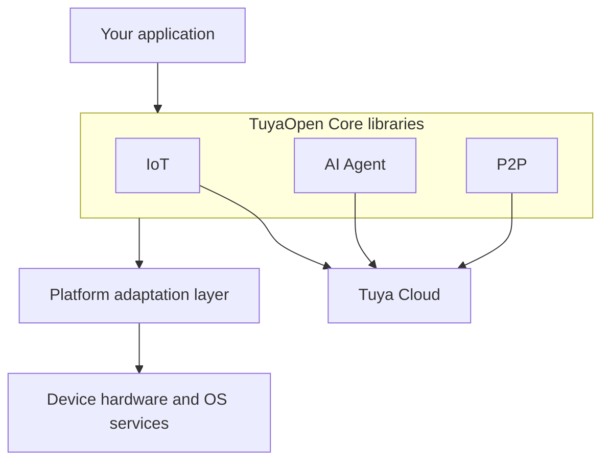

TuyaOpen Core is a device-side C SDK library for Tuya Cloud. You add the library to an existing device project, keep your operating system and code, and connect the device to Tuya Cloud. One secure connection then gives you three capability APIs: **IoT**, **AI Agent**, and **P2P**.

## Library, not a framework

TuyaOpen Core is a library you link — it does not own the device's boot flow, drivers, or scheduler. This distinguishes it from the full TuyaOpen framework.

| | TuyaOpen Core | TuyaOpen framework |
|---|---|---|
| Form | C libraries linked into a project | Complete framework with an OS stack, driver stack and application demos |
| For | An existing platform that needs Tuya Cloud | A new project that wants everything working out of the box |
| Cloud | Tuya Cloud | Tuya Cloud |

Both connect to the same cloud and share device identity, data points (DPs), and the app experience. Read [Get Started with the TuyaOpen framework](../quick-start/index.md) for the framework path.

## Architecture

The libraries run in the same address space as your application and reach system services only through a thin platform layer that the target provides.

## The three capability APIs

| API | Purpose | Build switch |
|---|---|---|
| [IoT](iot-api.md) | Device activation, authentication, data points, remote control, OTA | Always built |
| [AI Agent](agent-api.md) | Cloud-AI voice and text conversations, optional MCP tools | `CONFIG_ENABLE_AI_COMPONENTS` |
| [P2P](p2p-api.md) | Low-latency peer-to-peer audio and video, optional local storage | `CONFIG_ENABLE_TUYA_P2P` |

IoT is the foundation: it owns the cloud connection the other two use. LAN (local link) support is built by default, and BLE services are available when the platform provides a Bluetooth port.

## Platforms

Official platform support is provided for:

- **Linux** — generic POSIX, including Raspberry Pi
- **ESP-IDF** — Espressif chips, ESP-IDF v5.x
- **TuyaOpen / TuyaOS** — an ops-module source drop that binds to the existing TKL layer

Any platform can be supported by implementing the platform adaptation contract. See [Port to a new platform](port-to-platform.md).

## Next steps

- [Quick start on Linux](linux-quick-start.md) — build and run the demos
- [Add the library to a project](add-to-project.md) — CMake or ESP-IDF integration
- [Port to a new platform](port-to-platform.md) — the adaptation contract
