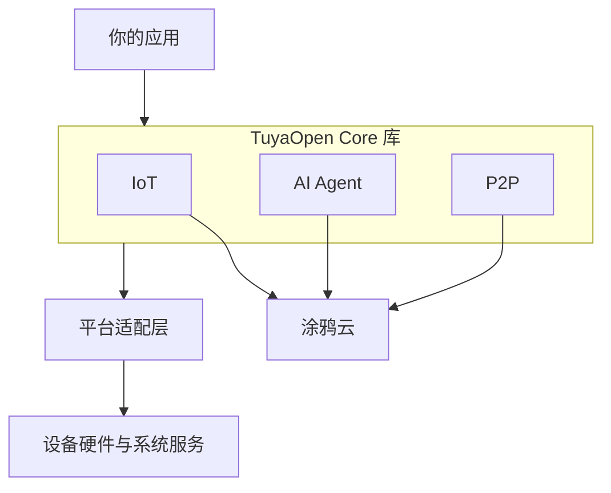

TuyaOpen Core 是面向涂鸦云（Tuya Cloud）的设备端 C SDK 库。把它加入已有的设备工程，保留现有的操作系统与代码，即可将设备连接到涂鸦云。一条安全连接之上提供三个能力 API：**IoT**、**AI Agent** 和 **P2P**。

## 是库，不是框架

TuyaOpen Core 是以链接方式使用的库，不接管设备的启动流程、驱动或任务调度，这是它与完整 TuyaOpen 框架的区别。

| | TuyaOpen Core | TuyaOpen 框架 |
|---|---|---|
| 形态 | 链接进工程的 C 库 | 完整框架，内置操作系统层、驱动层与应用示例 |
| 适用对象 | 已有平台、需要接入涂鸦云 | 全新项目、希望开箱即用 |
| 云端 | 涂鸦云 | 涂鸦云 |

两者连接同一个云，共享设备身份、数据点（DP）与 App 体验。框架的使用方式见 [TuyaOpen 框架快速开始](../quick-start/index.md)。

## 架构

这些库与你的应用运行在同一地址空间，只通过目标提供的薄薄平台层调用系统服务。

## 三个能力 API

| API | 用途 | 编译开关 |
|---|---|---|
| [IoT](iot-api.md) | 设备激活、鉴权、数据点、远程控制、OTA | 默认始终编译 |
| [AI Agent](agent-api.md) | 云端 AI 语音与文本对话，可选 MCP 工具 | `CONFIG_ENABLE_AI_COMPONENTS` |
| [P2P](p2p-api.md) | 低延迟点对点音视频，可选本地存储 | `CONFIG_ENABLE_TUYA_P2P` |

IoT 是基础，负责另外两个 API 共用的云端连接。局域网（本地连接）能力默认开启；当平台提供蓝牙适配时，还可使用 BLE 相关服务。

## 支持平台

官方提供的平台支持：

- **Linux** —— 通用 POSIX，包括树莓派
- **ESP-IDF** —— 乐鑫芯片，ESP-IDF v5.x
- **TuyaOpen / TuyaOS** —— ops module 源码接入，直接绑定到既有的 TKL 层

任意平台都可通过实现平台适配契约获得支持，详见 [适配新平台](port-to-platform.md)。

## 下一步

- [Linux 快速开始](linux-quick-start.md) —— 编译并运行示例
- [把库加入工程](add-to-project.md) —— CMake 或 ESP-IDF 集成
- [适配新平台](port-to-platform.md) —— 平台适配契约
